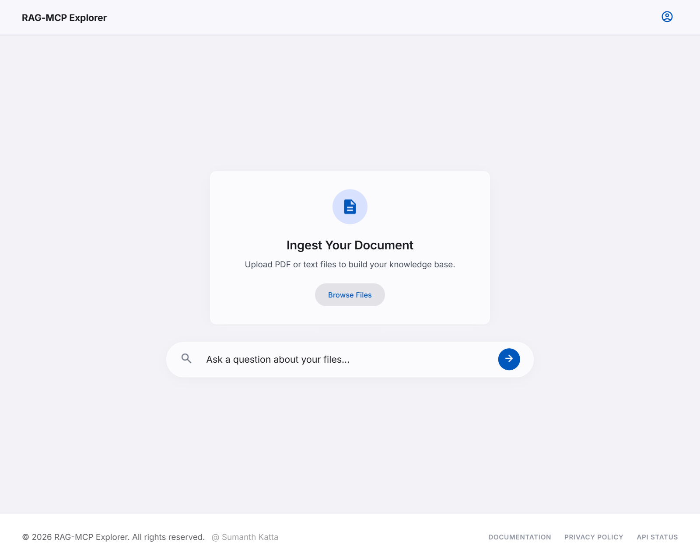
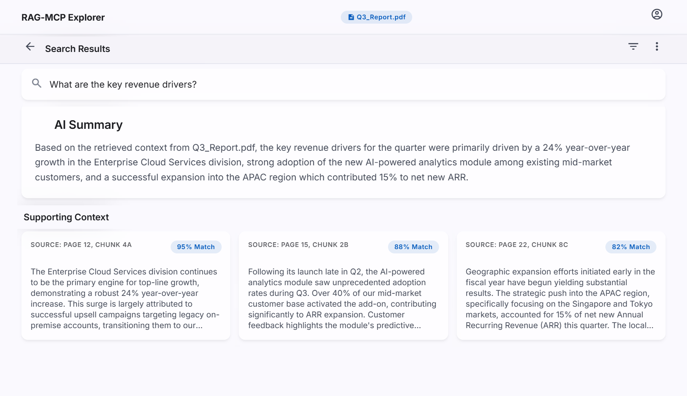

# ContextBridge AI

A small **MCP server** that gives LLM clients retrieval over your own documents. It chunks text, embeds it locally, stores it in ChromaDB, and exposes a `retrieve_documents` tool that any MCP-compatible client (such as Claude Desktop) can call.

## Why I built it

LLMs don't know what's in your notes or docs. Instead of pasting context into every chat, I wanted the model to look things up itself. MCP is the standard way to give a model a tool, so this project wires a local vector store to an MCP tool.

## How it works

```
sample.txt ──▶ ingestion.py ──chunks──▶ fastembed (bge-small-en-v1.5) ──▶ ChromaDB (./chroma_data)
                                                                              ▲
MCP client ──retrieve_documents(query)──▶ server.py (FastMCP, SSE :8000) ─────┘
```

1. **Ingest:** `ingestion.py` splits the source text into 200-character chunks with 30 characters of overlap (LangChain `RecursiveCharacterTextSplitter`).
2. **Embed:** chunks are embedded locally with `BAAI/bge-small-en-v1.5` through fastembed, so no external embedding API is needed.
3. **Store:** embeddings go into a persistent ChromaDB collection.
4. **Retrieve:** `server.py` runs a FastMCP server over SSE and exposes `retrieve_documents(query, n_results)`, which returns the closest chunks.

## Tech stack

Python · Model Context Protocol (FastMCP) · ChromaDB · fastembed · LangChain text splitters

## Running locally

```bash
git clone https://github.com/sumanthkatta-dev/ContextBridge-AI.git
cd ContextBridge-AI
python -m venv venv && source venv/bin/activate
pip install chromadb fastembed "mcp[cli]" langchain-text-splitters

python ingestion.py     # index sample.txt
python server.py        # MCP server on http://localhost:8000 (SSE)
```

Then add the server to your MCP client's config and ask it a question about the indexed document. `test_server.py` calls the retrieval function directly as a quick check.

## Roadmap

- PDF ingestion with page numbers kept as metadata
- A web dashboard for uploading files and inspecting retrieved chunks (early mockups below)
- A `requirements.txt` and proper pytest tests

| Upload & search (mockup) | Results view (mockup) |
|---|---|
|  |  |
